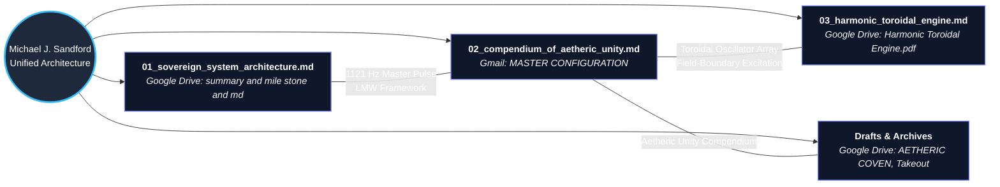

# Unified Workspace Master Index

This file links your **Sovereign System Architecture**, **Compendium of Aetheric Unity**, and **Harmonic Toroidal Engine** into a single cross-referenced map.

### File Directory
1. **`00_unified_workspace_index.md`**: Master cross-reference map linking all active projects across Drive and Gmail.
2. **`01_sovereign_system_architecture.md`**: Oneida Indian Nation TDS/IDSov infrastructure, 3-layer stack, 4-stage Charter Gateway, and 4-phase rollout state diagram.
3. **`02_compendium_of_aetheric_unity.md`**: The 4-node triangulation matrix (`NODE-001` to `NODE-004`), proprietary physics pairings (`LAW-001` to `LAW-003`), hardware arrays (`HW-001` to `HW-002`), and the 8-Volume directory mindmap.
4. **`03_harmonic_toroidal_engine.md`**: Closed-loop sympathetic resonance flow diagram and component breakdown (Driver, Walls, Base, Cap).