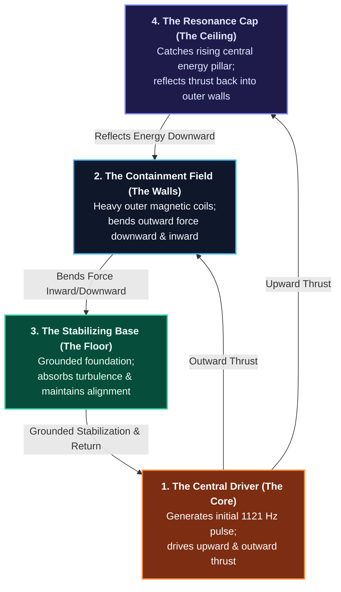

# Harmonic Toroidal Engine — System Overview

**Source:** Google Drive (`Public Overview Harmonic Toroidal Engine.pdf`)  
**Architecture Type:** Closed-Loop Sympathetic Resonance Engine

---

## Closed-Loop Energy Circulation Diagram

---

## Engineering Principles & Comparison

| Feature | Standard Mechanical Systems | Harmonic Toroidal Engine |
| :--- | :--- | :--- |
| **Energy Flow** | Open-loop; generates power and allows excess to dissipate. | **Closed-loop toroidal field**; continuously recycles kinetic and magnetic forces. |
| **Control Method** | Brute-force mechanical manipulation and heavy copper conduction. | **Sympathetic resonance**; hardware is tuned to natural vibrational frequencies (like a musical instrument). |
| **Boundary Control** | Physical friction and rigid containment barriers. | Magnetic deflection (**Containment Walls**) and upper reflection (**Resonance Cap**). |